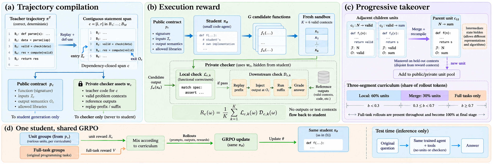
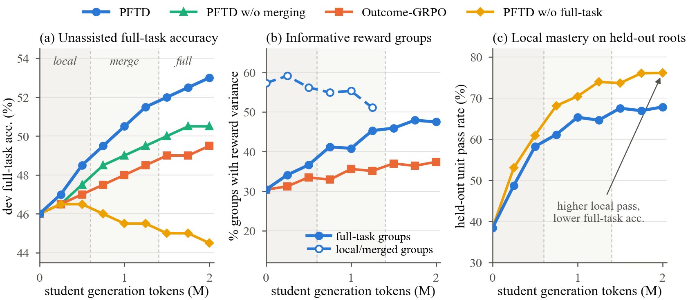
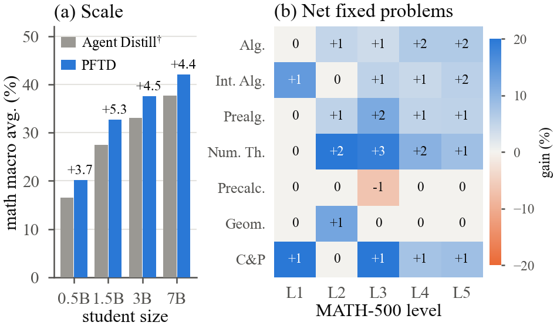
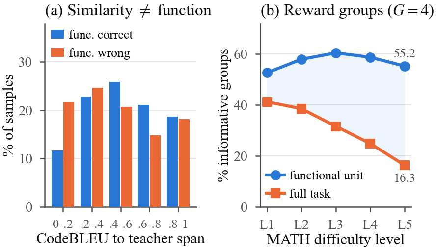
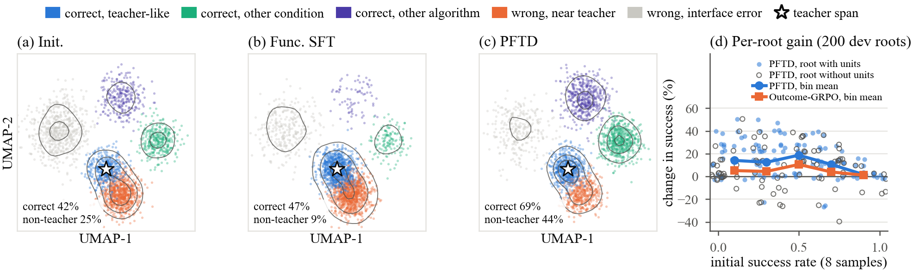

# PFTD: Progressive Functional Trajectory Distillation

**Imitate the Function, Not the Code: Progressive Functional Trajectory Distillation for Small Code Agents**

Anonymous core-code release accompanying the manuscript.

PFTD adds a training stage after agent distillation. It turns deterministic spans of a teacher's code trajectory into functional exercises, rewards the student's own implementations with private execution checks, and progressively removes intermediate interfaces until training returns to unassisted full tasks.

## Method



The same student handles all prompt types:

1. **Compile trajectories.** Recover complete Python statements, derive live-in and live-out interfaces, validate teacher-generated public contracts, and independently check re-parameterized instances.
2. **Reward functionality.** Evaluate each implementation on six hidden contexts. Reward is the fraction passing both the local functional check and downstream replay after output injection.
3. **Withdraw assistance.** Test mastery on four separate contexts. Recompile adjacent mastered spans into a parent that hides intermediate state. Reduce unit rollout-token shares from 60% to 30% to 0%.
4. **Update one policy.** Use clipped GRPO with exact vocabulary KL to the frozen initial Agent Distill policy. Only student-generated tokens receive loss; prompts and tool observations do not.

## Installation

Python 3.10 or later is required.

```bash
python -m venv .venv
# Linux: source .venv/bin/activate
# Windows: .venv\Scripts\activate
pip install -e .
python -m pftd config
```

## Isolated compilation and checking

Use Docker for generated or otherwise untrusted code:

```bash
docker build -f docker/Dockerfile -t pftd-checker:local .
python -m pftd compile --roots private/train_roots.jsonl --output artifacts/compiled
```

Each call runs in a separate container with no network, no host-data mounts, a read-only root filesystem, dropped capabilities, a 512 MB memory cap and a two-second execution timer. Candidate calls receive only their arguments and declared imports; downstream calls use a different process. Public and private compiled records are written into separate directories.

The compiler accepts explicit root parameterizations and independent semantic oracles. It does not manufacture those assets or accept teacher agreement as independent verification. An unsupported or unverified root remains eligible for full-task training. `docs/implementation.md` describes the input schema and interfaces.

## Training integration

The repository contains the upstream source snapshot and a PFTD-specific training entry point. PFTD settings target **one NVIDIA A100 80GB**, including 7B students. The inherited upstream scripts retain their original settings and are not PFTD launch configurations.

```bash
pip install -e "vendor/agent_distillation[docker]"
pip install -e ".[train,vllm]"
python -m pftd train \
  --roots private/train_roots.jsonl \
  --compiled artifacts/compiled \
  --adapter checkpoints/initial-agent-distill \
  --output outputs/pftd
```

Training also requires the original tool environment and math-grader dependencies. The inherited grader imports `latex2sympy2`; use the compatible implementation from GitHub: huggingface/Qwen2.5-Math, directory `evaluation/latex2sympy`, as specified by the upstream release. The Wikipedia retriever requires its corpus/index service. Factual QA grading uses the original GPT-4o-mini judging prompt and reads `OPENAI_API_KEY` from the environment, never from a committed key file.

The default sampler is vLLM with PEFT updates. A Transformers sampler is available through `--sampler transformers` for integration debugging; it is not the paper's throughput configuration. Both retain exact sampling token IDs and old log-probabilities. The frozen reference is a second copy of the inherited adapter on the same base model, not an unadapted base model.

Selected ablation switches are `--variant no_merge`, `--variant fixed_schedule`, `--variant outcome_only`, `--reward local`, and `--reward downstream`. These expose mechanism controls, not pre-reproduced ablation results. The exact timing of the paper's fixed-schedule variant is not specified in the manuscript; the included fixed-schedule control merges eligible adjacent units at stage-two checkpoints without mastery gating.

### Default protocol

| Setting | Value |
| --- | --- |
| Student initialization | Released Agent Distill adapter, rank 64, alpha 128 |
| Student sizes | 0.5B, 1.5B, 3B, 7B |
| Generation budget | 2,000,000 tokens, including failed candidates and readiness checks |
| Group size / sampling | 4 / temperature 1, top-p 1, no top-k truncation |
| Reward / readiness contexts | 6 / 4 disjoint contexts |
| Unit prompt / completion cap | 1,536 / 512 tokens |
| Full tasks | At most 5 steps, at most 1,024 new tokens per step |
| Learning rate / warm-up | 5e-6 / 20 updates |
| Clip / KL coefficient | 0.2 / 0.01 |
| Readiness | At least 0.75 in two consecutive checks |
| Stage boundaries | 30% and 70% of the total token budget |
| Checkpoint selection | Final checkpoint |

`configs/pftd.json` records the complete defaults. The training loop skips equal-reward groups, voids checker-failure groups, down-weights children after a merge, and falls back to children after three all-zero parent groups. It samples roots before units, so roots with no compiled units still receive training.

## Results reported in the manuscript

The following tables and figures reproduce the manuscript's reported results. This release does not bundle trained checkpoints or claim that the full experiments have been rerun.

### Eight-benchmark average accuracy (%)

| Student | Agent Distill (FTP + SAG) | PFTD, greedy | PFTD + SAG |
| --- | ---: | ---: | ---: |
| 0.5B | 21.90 | 22.41 | **24.16** |
| 1.5B | 30.55 | 32.33 | **34.21** |
| 3B | 36.60 | 37.48 | **39.23** |
| 7B | 42.68 | 43.87 | **45.51** |

Benchmarks: HotpotQA, MATH-500, MuSiQue, Bamboogle, 2WikiMultiHopQA, GSM-Hard, AIME and OlymMATH. Agent Distill values are the reported FTP + SAG configuration; they are not the non-FTP, non-SAG initialization used by the next table.

### Controlled mathematical comparison: 1.5B, greedy

| Method | MATH-500 | GSM-Hard | AIME | OlymMATH | Average |
| --- | ---: | ---: | ---: | ---: | ---: |
| Initial Agent Distill | 47.0 | 54.6 | 1.1 | 7.0 | 27.43 |
| Continued Trajectory SFT | 47.4 | 55.2 | 2.2 | 6.5 | 27.83 |
| Functional Curriculum SFT | 48.2 | 56.4 | 2.2 | 7.5 | 28.58 |
| Outcome-GRPO | 49.4 | 57.6 | 3.3 | 8.0 | 29.58 |
| Prefix-GRPO | 49.8 | 58.2 | 3.3 | 8.0 | 29.83 |
| Prefix-GRPO, +25% budget | 50.2 | 58.8 | 4.4 | 8.5 | 30.49 |
| **PFTD** | **52.6** | **61.8** | **6.7** | **10.0** | **32.77** |

Averages are copied from the manuscript and computed there from unrounded scores, not recomputed from the displayed one-decimal entries.

### Training dynamics and generalization





### Function versus form





## Code map

```text
pftd/
  interfaces.py     Conservative def-use analysis and statement spans
  compiler.py       Replay, interfaces, oracles, mutation audit and recompilation
  contracts.py      Public prompt whitelist and output semantics
  teacher.py        Restricted contract-generation requests
  worker.py         Isolated execution worker
  sandbox.py        Docker execution boundary
  checker.py        Local and downstream checks; group failure attribution
  curriculum.py     Token ledgers, readiness, merging and fallback
  grpo.py           Masked clipped objective and exact vocabulary KL
  policy.py         PEFT updates and optional vLLM sampling
  trainer.py        Shared-policy training loop
  upstream.py       Original CodeAct prompt, tools and grader bridge
configs/            Paper defaults
figures/            Figures copied from the manuscript
vendor/             Agent Distillation source
docs/               Implementation and release notes
```

## Scope

The Linux/CUDA vLLM–PEFT path and Docker deployment require target-environment validation. GPU memory usage, throughput and benchmark accuracy have not been established by this release.

This is a readable implementation of the core method, not a release of the original experiment artifacts. Compilation is intentionally conservative: unsupported syntax, hidden dependencies, missing independent oracles and invalid parameterizations reject units instead of supplying guessed rewards. The inherited general-purpose agent executor is separate from the hardened unit checker; operate it only in a dedicated, isolated training environment.

## Attribution and license

Upstream source: GitHub: Nardien/agent-distillation.

Associated work: Kang et al., *Distilling LLM Agent into Small Models with Retrieval and Code Tools* (2025). The upstream project builds on smolagents, Search-R1 and TRL. Original copyright and license notices are retained. PFTD additions use Apache-2.0; see `LICENSE`, `NOTICE` and `docs/UPSTREAM.md`. Manuscript figures and third-party benchmark material retain their respective rights and attribution.
